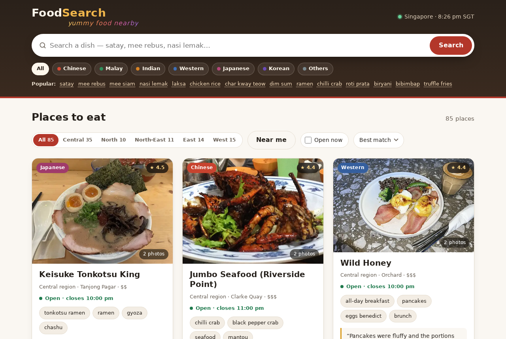
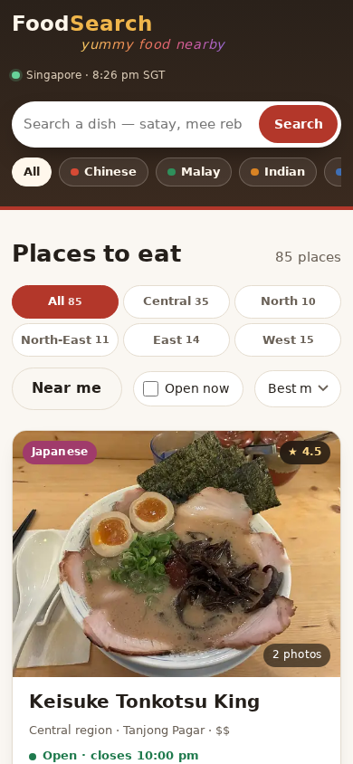

# FoodSearch

**yummy food nearby** — find food in Singapore by the dish you're craving.

Search by specialty (*satay*, *mee rebus*, *nasi lemak*, *laksa*…), filter by
Singapore region and cuisine, and see at a glance whether a place is open right
now, how far away it is, two photos and its top reviews.

Built with the Python standard library only — **no framework, no API keys, no
database, and no network calls at runtime**. The dataset and photos ship with
the app.

> **Demo data.** Listings are real venues, but opening hours and reviews are
> illustrative samples, not live information. Confirm before visiting. See
> [Data and photos](#data-and-photos).

---

## Screenshots

| Laptop (1280px) | Phone (390px) |
| --- | --- |
|  |  |

Three columns with the region tabs inline on a laptop; a single column with the
tabs as a 3×2 grid and a compact header on a phone.

## Features

**Dish search** — works on what is served, not just business names.

- Partial words (`prat`, `chic`) and multi-word dishes.
- Typos and transpositions (`lksa`, `chciken`, `bimbap`) — matched only when an
  exact search finds nothing, and always flagged as approximate.
- Local spellings (`char kuay teow`, `sate`, `dosa`, `otak otak`).

**Categories** — Chinese, Malay, Indian, Western, Japanese, Korean, Others.

**Regions** — Central, North, North-East, East and West as a tab bar in front of
"Near me". Each tab shows how many places match your *current* search, and
combines with category, "Open now" and sorting. If a dish exists elsewhere, the
empty state tells you where.

**Opening hours** — a live badge per listing ("Open · closes 7:30 pm", "Closed ·
opens 10:00 am tomorrow") computed server-side in Singapore time. Handles
overnight sessions (`11:00–02:00`), split lunch/dinner services and closed days.

**Near me** — opt-in geolocation; with a location, cards show distance and
"Nearest" sorting works. Without one, "Nearest" orders from the city centre and
says so.

**Detail pages** — description, specialties, two credited photos, the full week's
hours, and top reviews sorted by rating then recency, with a Maps link.

## Run it

Nothing to install. Requires Python 3.9+.

```bash
cd backend
python3 app.py                 # http://localhost:8000
python3 app.py --open          # ...and open your browser
python3 app.py --port 9000     # different port (steps forward if busy)
python3 app.py --host 0.0.0.0  # reachable from a phone on the same Wi-Fi
```

In a container it listens on `HOST=0.0.0.0` and `PORT` from the environment, with
`--single-port` so it never drifts off the port the platform probes.

## API

The UI uses these, and they work on their own:

```bash
GET /api/search?q=satay&category=Malay&region=East&open=1&sort=distance&lat=1.29&lng=103.85
GET /api/eateries/328-katong-laksa     # one listing with its full weekly hours
GET /api/meta                          # city, categories, regions, popular searches
GET /health                            # readiness probe
```

`/api/search` returns `meta` (filters applied, count, whether results were
typo-relaxed, server time, distance reference) and `results` (full listing data,
photos with attribution, open state, top review, optional distance).

The full schema is in [`openapi.json`](openapi.json).

## What's inside

```
backend/
  app.py                  # the whole app: data, search, hours, rendering, HTTP
  data/eateries.json      # 85 Singapore eateries
  static/app.css, app.js  # styling and live-search enhancement
  static/photos/          # 2 WebP dish photos per listing + manifest.json credits
  tests/                  # search, hours, HTTP and deploy-contract tests
cicd/Dockerfile.backend   # Python 3.12 slim, non-root, HEALTHCHECK on /health
substrait.yaml            # deploy description (no database, no services)
openapi.json              # published API description
tools/                    # dataset and photo maintenance scripts
PRD.md                    # product requirements
```

| Path | Purpose |
| --- | --- |
| `backend/app.py` | Data loading, search, hours logic, HTML rendering, HTTP server |
| `backend/data/eateries.json` | 85 eateries: 66 confirmed, 19 labelled indicative |
| `backend/static/photos/` | 170 WebP photos (~4.5 MB) with a credit/licence manifest |
| `backend/tests/` | 45 tests |
| `cicd/Dockerfile.backend` | Container image |
| `tools/fetch_photos.py` | Rebuild the photo bundle from Wikimedia Commons |
| `tools/repick_photos.py` | Re-assign photos so no image is reused across listings |
| `tools/fetch_commons_candidates.py` | Build a candidate pool per dish from Commons search |
| `tools/add_region_eateries.py` | Seed that gave every region real coverage |
| `tools/expand_eateries.py` | Seed that added coffee shops and restaurants |
| `tools/verify_eateries.py` | Audit of closed/unverified venues; removes them |

There is **no database**: listings and photos are read from files in the image,
so the deploy declares no `database:` and ships no migrations.

## Data and photos

**The dataset is demo data.** Venue names and areas are real, but opening hours
and reviews are illustrative samples written for demonstration. Do not treat
them as authoritative.

**Verification status.** Every listing carries a `verified` flag:

- **66 confirmed** — the original curated set plus well-known Singapore venues
  (Maxwell, Chinatown Complex, Bedok 85, Changi Village, Clementi 448, Taman
  Jurong, Chomp Chomp and similar).
- **19 indicative** — real malls, chains or locations where the exact outlet is
  not confirmed. Shown with an "Indicative listing" badge on the card and an
  explanation on the detail page.

**Closure audit (2026-11-25).** Three confirmed-closed venues were removed —
JCube (closed Aug 2023), Tampopo at Liang Court (demolished 2021) and The
Grandstand at Turf City (vacated 2024) — along with listings that could not be
confirmed as real businesses. `tools/verify_eateries.py` records the audit, and
tests prevent those venues from returning.

> **Known limitation:** "confirmed" means the venue is known to exist, not that
> its current operating status has been checked individually. A real directory
> import is the right next step before production use.

**Photos** are Creative Commons images from Wikimedia Commons. Author, licence
and source page are stored in `backend/static/photos/manifest.json` and shown
under each image on the detail page. No image is shared between listings.

Rebuild or check the bundle:

```bash
python3 tools/fetch_photos.py --verify    # coverage report
python3 tools/repick_photos.py --verify   # check for reused photos
python3 tools/verify_eateries.py          # closed/unverified audit (dry run)
```

Photo fetching needs Pillow for WebP encoding (`pip install pillow`); without it
images are stored as-is.

## Tests

```bash
cd backend
python3 -m unittest discover -s tests -v
```

45 tests cover dish search and typo recovery, category and region filtering,
opening-hours edge cases (overnight, split service, closed days), the HTTP API,
static-file safety, and deploy-contract invariants including "closed venues stay
removed".

## Deploy

Deploys to [Substrait](https://substrait.build) as a single backend container
(no frontend, no database):

```bash
/substrait:deploy                  # ship the working tree
/substrait:deploy --env dev --watch
```

The backend serves `GET /health` and its API under `/api`, as the platform
requires. `substrait.yaml` declares no `database:` and no backing services —
by design.

## License and credits

Application code: as declared in the repository. Photos are Creative Commons,
attributed individually in `backend/static/photos/manifest.json` and on each
detail page.